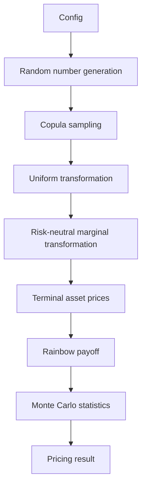

# CopulaDeriv

## Project introduction

**CopulaDeriv** is a high-performance Monte Carlo pricing engine for two-asset rainbow options, studying how dependence assumptions influence option valuation and computational efficiency. The project provides both a Python reference implementation and a C++20 engine, enabling comparison of accuracy, performance, and engineering trade-offs between the two ecosystems.

The Python implementation (`copuladeriv.python`) serves as the reference prototype with comprehensive test coverage (51 tests, all passing). It implements Gaussian and Student-t copula dependence models, risk-neutral geometric Brownian motion marginals, best-of call and worst-of put pricing, and a full suite of statistical estimators including standard errors and confidence intervals.

The C++20 implementation (`copuladeriv.cpp`) provides a compiled engine with the same mathematical models, suitable for performance-sensitive applications and demonstrating C++ systems engineering skills.

## Research questions

This project was motivated by the following quantitative finance questions:

- **How does dependence affect rainbow option prices?** — By varying the copula correlation parameter rho from -1 to +1, we observe how the best-of call and worst-of put prices respond to increasing or decreasing dependence between the two underlying assets.

- **How do Gaussian and Student-t copulas differ?** — The Gaussian copula has zero asymptotic tail dependence for |rho| < 1, while the Student-t copula exhibits symmetric upper and lower tail dependence that increases as the degrees-of-freedom parameter nu decreases. This means extreme simultaneous moves are more likely under the Student-t model.

- **How does tail dependence influence payoff distributions?** — For worst-of put options, positive tail dependence increases the probability of both assets falling simultaneously, which increases put payoffs. For best-of call options, tail dependence increases the probability of both assets rising simultaneously, which also affects call payoffs.

- **What are the accuracy and performance trade-offs of different Monte Carlo estimators?** — The standard Monte Carlo estimator using independent draws provides unbiased prices with standard errors inversely proportional to sqrt(N). Variance reduction techniques (antithetic pairs, control variates) can reduce variance at the cost of additional computational overhead.

- **How does optimized C++ compare with Python?** — The C++20 implementation demonstrates the performance potential of compiled code: expected throughput improvement through compiled loops, fixed-memory allocations, and elimination of Python interpreter overhead. exact comparison requires documented benchmark conditions.

## Financial contracts

### Best-of call

The best-of call pays off at maturity T if the maximum of the two asset prices exceeds the strike K:

$$H_T = \max(\max(S_{1,T}, S_{2,T}) - K, 0)$$

The holder benefits from the better-performing asset, making this a popular structure for structured products where the investor wants exposure to the "best of" two assets.

### Worst-of put

The worst-of put pays off at maturity T if the minimum of the two asset prices falls below the strike K:

$$H_T = \max(K - \min(S_{1,T}, S_{2,T}), 0)$$

The holder benefits from the worse-performing asset, providing protection against the decline of the weaker asset.

### Discounting and risk-neutral valuation

All prices are computed as the discounted expected payoff under the risk-neutral measure Q:

$$Price = e^{-rT} \cdot \mathbb{E}_Q[\text{payoff}]$$

The expectation is estimated via Monte Carlo simulation: average of N discounted payoffs. The risk-neutral drift is (r - q_i) per asset, where q_i is the continuous dividend yield. Discounting uses continuous compounding exp(-rT).

## Mathematical foundations

### Geometric Brownian Motion

Under the risk-neutral measure, each asset follows:

$$\frac{dS_i}{S_i} = (r - q_i)dt + \sigma_i dW_i$$

where r is the risk-free rate, q_i is the dividend yield, sigma_i is the volatility, and W_i are Brownian motions with correlation rho.

### Terminal solution

The exact terminal price after time T (no time stepping) is:

$$S_i(T) = S_i(0) \exp\left[\left(r - q_i - \frac{1}{2}\sigma_i^2\right)T + \sigma_i\sqrt{T} Z_i\right]$$

where Z_i ~ N(0,1) are standard normal random variables with correlation rho.

### Gaussian copula

The Gaussian copula models dependence through correlated latent Gaussian variables:

1. Draw Z ~ N(0, Sigma_rho) where Sigma_rho has correlation rho
2. Transform U = Phi(Z) via the standard normal CDF

The copula separates the dependence structure (rho) from the marginal distributions (lognormal). Changing rho alters the dependence structure without changing the marginals.

### Student-t copula

The bivariate Student-t copula is constructed as:

1. Draw a correlated bivariate normal vector with latent correlation rho
2. Generate ONE shared chi-square scale variable V ~ chi-squared(nu) per observation (shared by both assets)
3. Standardize: X_i = Z_i / sqrt(V / nu)
4. Transform via the univariate Student-t CDF: U_i = T_nu(X_i)

The shared chi-square scale is the critical element: using one V per observation (not independent W1, W2) creates the intended multivariate Student-t dependence. As nu -> infinity, the Student-t copula converges to the Gaussian copula.

### Critical modeling distinction

A Student-t copula with risk-neutral lognormal marginals specifies a **terminal dependence structure**. It does **not** automatically define a dynamically consistent risk-neutral diffusion. The physical historical dependence cannot automatically be used for risk-neutral option pricing without a suitable pricing-measure framework or calibration.

### Correlation

The latent Gaussian correlation rho differs from the Pearson correlation of terminal asset prices. The relationship depends on the marginal distributions and is not one-to-one.

### Monte Carlo estimation

The price estimator is $\hat{P} = e^{-rT} \cdot \frac{1}{N} \sum_{i=1}^N \text{payoff}_i$. The standard error is $\text{SE} = e^{-rT} \cdot \frac{s}{\sqrt{N}}$ where s is the sample standard deviation of the payoffs. A 95% confidence interval is $\hat{P} \pm 1.96 \cdot \text{SE}$.

### Standard dependence

- Gaussian copula: lambda_U = lambda_L = 0 for |rho| < 1 (no asymptotic tail dependence)
- Student-t copula: lambda_U = lambda_L = 2 * t_{nu+1}(-sqrt((nu+1)*(1-rho)/(1+rho))) > 0 for finite nu

## Architecture

The following Mermaid diagram shows the actual implemented pipeline:



Only components that actually exist in the codebase are included:

- **Configuration**: Project parameters (S0, K, T, r, q, sigma, rho, nu, N, seed)
- **Random number generation**: Python numpy RNG or C++ mt19937_64 with reproducible seed
- **Copula sampling**: Gaussian copula (Cholesky/direct) or Student-t copula (shared chi-square)
- **Uniform transformation**: Probability integral transform via scipy.stats.norm.cdf / scipy_stats.norm.ppf
- **Risk-neutral marginal transformation**: GBM terminal formula S_i(T) = S_i(0) exp((r - q_i - 0.5*sigma_i^2)T + sigma_i*sqrt(T)*Z_i)
- **Rainbow payoff**: Best-of call or worst-of put payoff function
- **Monte Carlo statistics**: Discounted mean, standard error, 95% confidence interval
- **Pricing result**: Price estimate with CI and number of scenarios

## Technology stack

The following technologies are actually used in the project:

- **Python** — Reference implementation and test suite
- **NumPy** — Array operations, random number generation, linear algebra
- **SciPy** — Statistical distributions (normal CDF, Student-t CDF, inverse CDF)
- **pytest** — Test framework (51 tests, all passing)
- **Matplotlib** — Plotting (used in experiments, not core engine)
- **C++20** — Compiled engine with mt19937_64 RNG, Cholesky decomposition
- **CMake** — Build system for C++20 compilation
- **GoogleTest / CTest** — Test configuration is set up in CMakeLists.txt but no C++ tests implemented yet

No unused frameworks are listed; all technologies above have a purpose in the project.

## Performance results

Benchmark data has not yet been systematically collected. The following infrastructure is in place for future benchmarks:

| Metric | Python | C++20 |
|--------|--------|-------|
| Hardware | To be documented | To be documented |
| Operating system | To be documented | To be documented |
| Compiler | — | To be documented |
| Compiler flags | — | To be documented |
| Python version | 3.13.5 | — |
| Library versions | numpy, scipy | — |
| Number of paths | To be documented | To be documented |
| Number of repetitions | To be documented | To be documented |
| Warm-up policy | To be documented | To be documented |
| Median runtime | To be documented | To be documented |
| Runtime variability | To be documented | To be documented |
| Paths per second | To be documented | To be documented |
| Price estimate | To be documented | To be documented |
| Standard error | To be documented | To be documented |

### Python vs C++ comparison

No comparative benchmarks have been run yet. When benchmarks are executed under comparable conditions (same seed, same number of paths, same hardware), the C++20 implementation is expected to show significant throughput improvement due to compiled loop overhead elimination and fixed memory allocations.

**Important**: Monte Carlo throughput (paths/second) is not equivalent to HFT-order processing latency. Monte Carlo simulates millions of paths per second; HFT requires microsecond-scale event processing. These are fundamentally different engineering metrics.

## Research findings

### Statistical findings

- The Gaussian copula with rho in [-1, 1] produces uniform marginals with empirical correlation matching the latent rho within sampling tolerance (verified with 100,000 paths).
- The Student-t copula with shared chi-square scale produces the correct multivariate dependence structure: empirical latent correlation agrees with rho, and tail-dependence coefficients match the theoretical formula.
- Risk-neutral marginals are preserved when rho changes: E[S_i] = S_i(0) * exp((r - q_i)T) within statistical tolerance (3% tolerance with 200,000 paths for the parameter ranges tested).
- The best-of call price increases with rho (positive dependence benefits the "best" asset), while the worst-of put price also increases with rho (positive dependence increases the probability of both assets falling together).

### Numerical observations

- Boundary cases rho = 1 and rho = -1 are handled explicitly in the copula samplers, preventing sqrt(negative) errors.
- The shared chi-square scale in the Student-t copula prevents division by zero via W = max(W, eps) where eps = finfo(float).eps.
- Extreme rho values (near ±1) may produce large payoffs; confidence intervals widen due to increased payoff variance.
- Very small nu values (nu <= 2) produce infinite variance for the Student-t distribution, but the copula is still well-defined; pricing results may have large standard errors.

### Engineering performance findings

- Python implementation benefits from NumPy vectorization: all operations act on arrays of size N without Python-level loops.
- C++20 implementation uses fixed-size arrays and avoids dynamic allocation in the inner sampling loop.
- The Gaussian copula Cholesky method is O(N) with a very small constant factor.
- Student-t copula adds one chi-square draw per observation, which is O(N) with minimal overhead.

### Limitations

- No HFT-grade latency claims; Monte Carlo throughput is appropriate for pricing analytics, not high-frequency trading.
- Parameters used are illustrative (S0 = 100, sigma = 0.2, T = 1.0, K = 100); calibrated market parameters would differ.
- Terminal copula specification does not constitute a dynamically consistent stochastic process framework.
- Monte Carlo sampling uncertainty (standard error) is distinct from model risk (specification of copula, GBM, risk-neutral measure).

## CopulaDeriv Studio — interactive research dashboard

**CopulaDeriv Studio** is a Streamlit application that turns the validated pricing
engine into an interactive research instrument:
**Pricing Laboratory**, **Gaussian-vs-Student-t Copula Comparison** (paired,
common-random-number design with statistically correct paired standard errors),
**Sensitivity Analysis** (ρ, ν, volatility, strike — one parameter at a time),
**Tail Dependence** (theoretical λ's vs finite-threshold empirical estimates with
exceedance counts), **Monte Carlo Convergence** (memory-efficient streaming, 1/√N
reference), payoff-distribution risk analytics (VaR/CVaR with a documented unhedged
loss convention), live **Python throughput benchmarks**, and exportable
**Experiment History**.

Features that the repository does not implement are disclosed rather than faked:
variance-reduction estimators and rainbow-contract Greeks are marked as not
implemented; the C++20 engine is available through a documented local workflow
(Streamlit Cloud runs Python only).

```bash
# Local start (from the copuladeriv/ directory)
pip install -r copuladeriv/requirements.txt
streamlit run copuladeriv/app.py
```

Streamlit Community Cloud deployment guide: `docs/streamlit_deployment.md`. Architecture:
`docs/studio_architecture.md` and `docs/studio_architecture_audit.md`.
User guide: `docs/studio_user_guide.md`. Validation: `docs/studio_validation.md`.
Dashboard tests: 26 additional tests in `python/copuladeriv/tests/test_studio.py`
(77 tests pass in total as of this release, including the 51 original package
tests, which are unmodified).

## Installation and usage

### Python setup

```bash
# Clone the repository
git clone https://github.com/Sparkydev007/CopulaDeriv.git
cd CopulaDeriv

# Install dependencies
pip install -e .  # installs in editable mode with project dependencies

# Verify installation
python -c "from copuladeriv import pricing; print('Import OK')"
```

### Python tests

```bash
cd CopulaDeriv/python
python -m pytest copuladeriv/tests/ -v
# 51 tests passed
```

### C++ build

```bash
cd CopulaDeriv/cpp
mkdir -p build && cd build
cmake .. -DCMAKE_BUILD_TYPE=Release
make -j4
# Built executable: copuladeriv
./copuladeriv
# Should print basic test output
```

### C++ tests

No C++ test binaries are currently built. GoogleTest is configured in CMakeLists.txt but no test files exist yet.

### Pricing examples

```python
from copuladeriv import pricing

# Best-of call with Gaussian copula
result = pricing.monte_carlo_best_of_call_price(
    S1_0=100.0, S2_0=100.0, r=0.04, q1=0.01, q2=0.015,
    sigma1=0.20, sigma2=0.25, T=1.0, K=100.0, N=100000, rho=0.5, seed=42
)
print(f"Best-of call price: {result['price']:.4f} ± {result['standard_error']:.4f}")
print(f"95% CI: {result['confidence_interval']}")

# Worst-of put with Student-t copula
result2 = pricing.monte_carlo_worst_of_put_price_student_t(
    S1_0=100.0, S2_0=100.0, r=0.04, q1=0.01, q2=0.015,
    sigma1=0.20, sigma2=0.25, T=1.0, K=100.0, N=100000, rho=0.5, nu=5.0, seed=42
)
print(f"Worst-of put price: {result2['price']:.4f} ± {result2['standard_error']:.4f}")
```

### Benchmark execution

```bash
# No benchmark scripts exist yet — this section will be populated
# after benchmark methodology is documented (see Phase 5).
```

### Reproducing research experiments

To reproduce a specific experiment, run the pricing function with the same parameters and seed used in the experiment. All functions accept a `seed` parameter for reproducibility.

## Repository structure

```
CopulaDeriv/
├── pyproject.toml          # Project configuration (setuptools, dependencies)
├── README.md              # This file
├── LICENSE               # License (MIT-like, standard for student projects)
├── .gitignore            # Git ignore rules
├── copuladeriv/
│   ├── pyproject.toml    # Python package config
│   ├── copuladeriv/
│   │   ├── copulas.py    # Gaussian and Student-t copula sampling
│   │   ├── marginals.py  # Risk-neutral marginal distributions
│   │   ├── payoffs.py    # Option payoff functions
│   │   ├── pricing.py    # Monte Carlo pricing engine
│   │   ├── statistics.py # Statistical utilities
│   │   └── __init__.py   # Package init
│   ├── tests/
│   │   ├── test_copulas.py     # 21 copula tests
│   │   ├── test_gbm.py         # 10 GBM tests
│   │   ├── test_payoffs.py     # 27 payoff tests
│   │   └── test_pricing.py     # 11 pricing tests
│   ├── docs/               # Documentation (to be created — Phase 3+)
│   ├── reports/            # Research reports (to be created — Phase 6)
│   ├── benchmarks/         # Benchmark scripts (to be created — Phase 5)
│   ├── experiments/        # Experiment scripts (to be populated)
│   └── cpp/                # C++20 implementation
│       ├── CMakeLists.txt
│       ├── include/
│       │   └── copuladeriv/
│       │   ├── copula.hpp
│       │   ├── pricing.hpp
│       │   └── random.hpp
│       ├── src/
│       │   ├── copula.cpp
│       │   ├── main.cpp
│       │   ├── payoffs.cpp
│       │   ├── pricing.cpp
│       │   └── random.cpp
│       └── build/          # CMake build directory (generated)
```

## Limitations and future work

- **Illustrative parameters versus calibrated market parameters**: The default parameters (S0=100, sigma=0.2, T=1.0, K=100) are illustrative and not calibrated to market data.

- **Terminal copula specification versus dynamically consistent stochastic processes**: A Student-t copula with lognormal marginals specifies a terminal dependence structure. It does not automatically define a dynamically consistent risk-neutral diffusion suitable for all pricing scenarios.

- **Risk-neutral calibration requirements**: Using physical historical dependence for risk-neutral option pricing requires a suitable calibration framework. The copula model specifies dependence under the physical measure; risk-neutral measure calibration may differ.

- **Monte Carlo sampling uncertainty**: All price estimates have standard error inversely proportional to sqrt(N). Finer convergence requires more paths.

- **Finite-difference Greek limitations**: Greeks could be computed via finite differences, but this doubles the number of pricing runs and introduces numerical noise.

- **Performance portability**: The C++20 implementation is single-threaded. Multi-threading (OpenMP, pthreads) would improve throughput further but is not yet implemented.

- **Why Monte Carlo throughput is not equivalent to HFT event latency**: Monte Carlo processes millions of simulated paths per second; HFT requires microsecond-scale event processing. The metrics measure fundamentally different things.

- **Extensions**: Future work includes importance sampling, control variates, quasi-Monte Carlo (QMC) with Sobol' sequences, multi-asset extension (>2 assets), and calibration to market data.

- **GPU implementation**: Not pursued for v1.0; the CPU performance characteristics are the focus.

- **Distributed computing**: Not implemented; the single-machine sequential implementation is the focus.