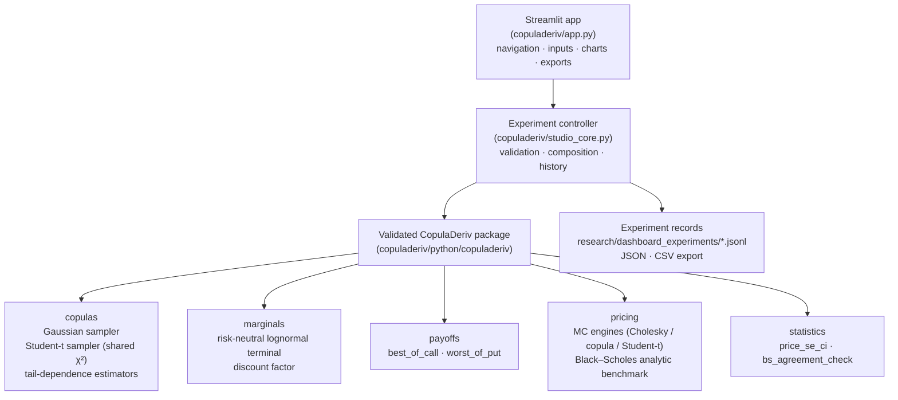
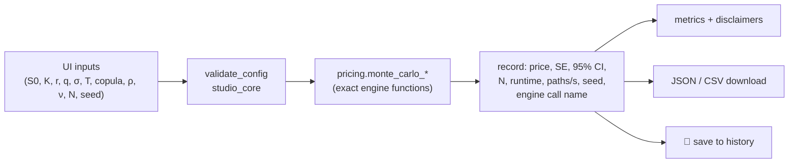
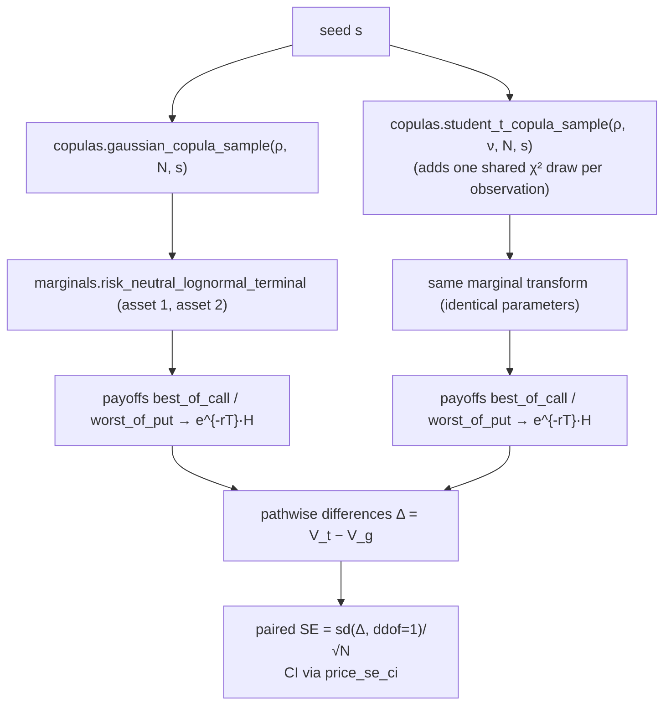

# CopulaDeriv Studio — Application Architecture

## 1. High-level architecture

## 2. Data flow of a Pricing Laboratory run

Nothing financial is computed in the UI layer: the app displays exactly what the
engine returns and decorates it with uncertainty language.

## 3. Data flow of the paired copula comparison (CRN)

Key property: both samplers consume `standard_normal((2, N))` first from
`default_rng(seed)`, so the latent Gaussian vector is shared; the χ² draw only
extends the Student-t stream. This produces genuinely paired samples and a paired
SE computed from payoff **differences** — never from two independent SEs.

## 4. Streaming convergence

Path counts above 100 000 are split into chunks of ≤ 100 000 paths with
deterministic sub-stream seeds (`base_seed + chunk·1000003`). Counter aggregates
(n, ΣV, ΣV²) combine the chunks, so memory stays bounded and the estimator equals
the composite stream exactly — verified by
`test_convergence_single_chunk_matches_standard_pipeline`.

## 5. Experiment history

JSON-lines file `research/dashboard_experiments/experiments.jsonl` (append-only,
never silently overwritten). Each record carries `experiment_id`, UTC timestamp,
studio version, copula, contract, every financial parameter, seed, result
metrics, runtime and `experiment_kind` (`single_pricing`,
`paired_copula_comparison`, `convergence`). Storage is non-durable on Streamlit
Community Cloud; export buttons exist on every experiment page.

## 6. Component boundaries (what must not change)

- All formulas live in `copuladeriv/python/copuladeriv/` (see
  `docs/studio_architecture_audit.md` §2 and §7).
- `studio_core.py` may only compose, validate, time and record engine calls.
- The C++20 engine stays an independent local tool (`copuladeriv/cpp/`); the app
  documents it but does not embed or fake it.
